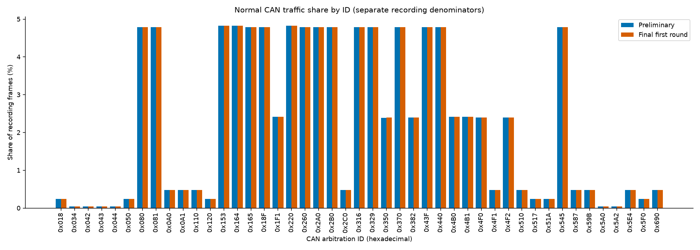
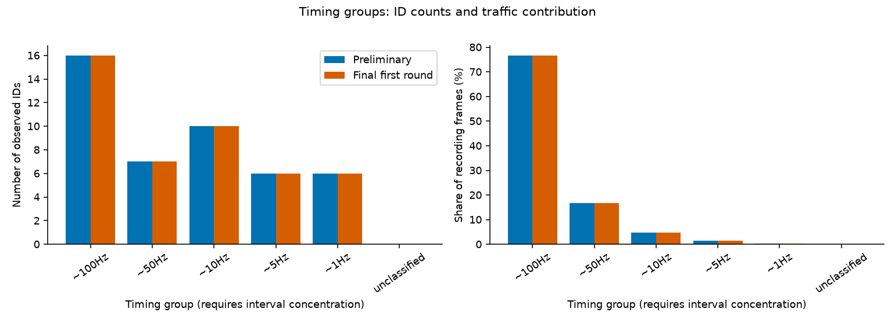
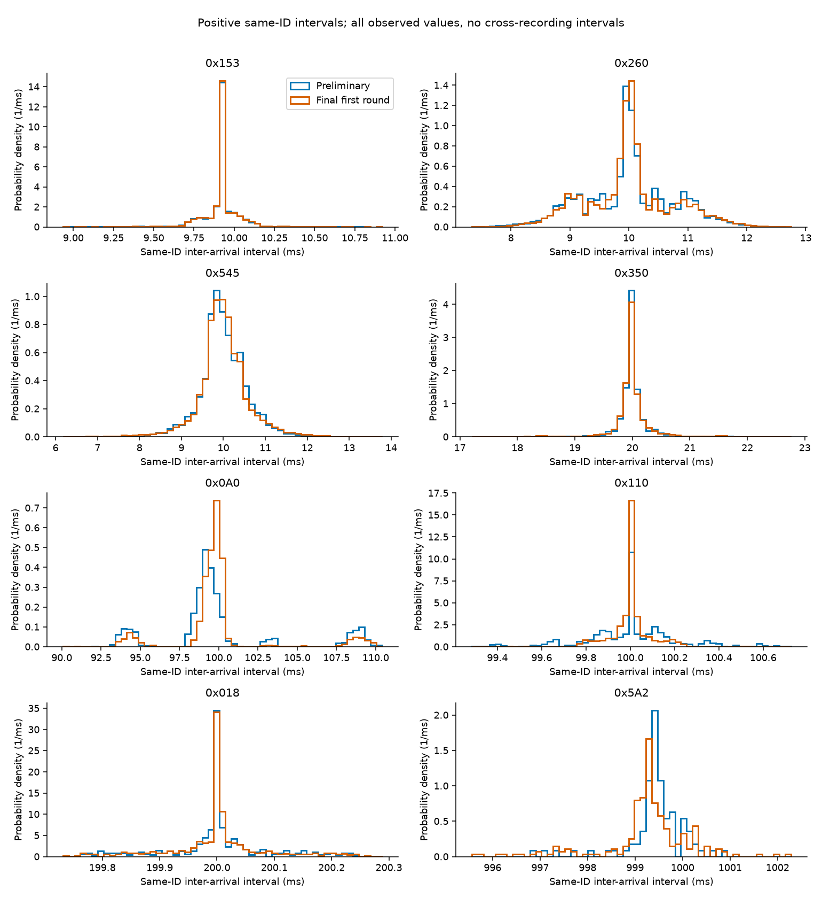
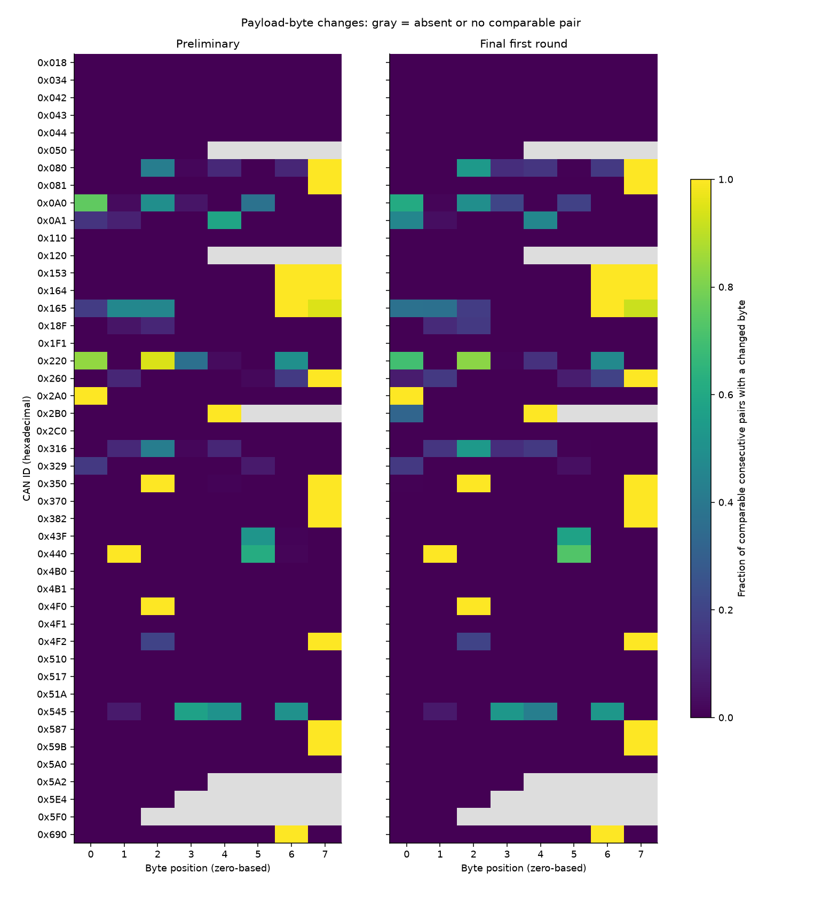
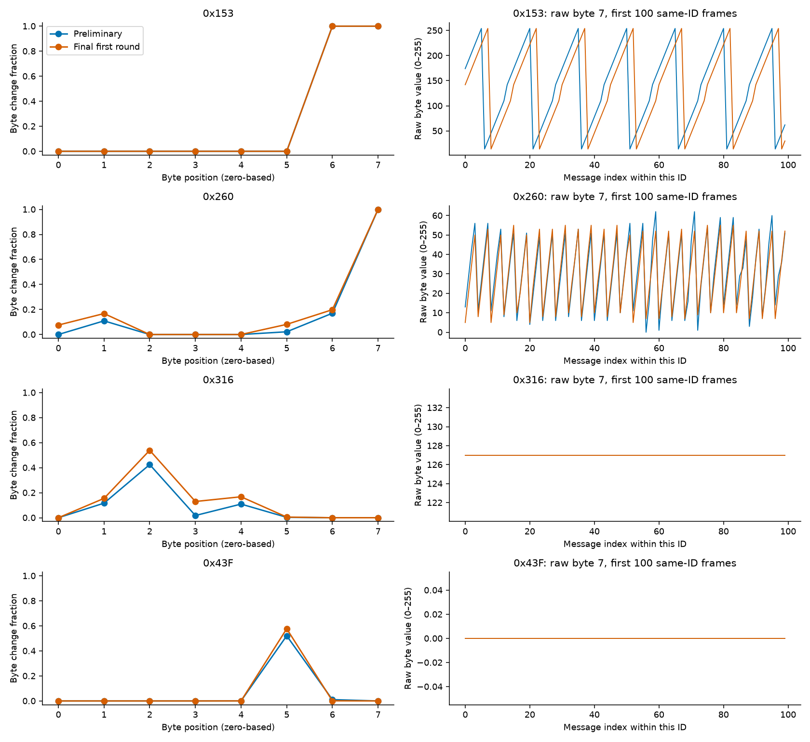
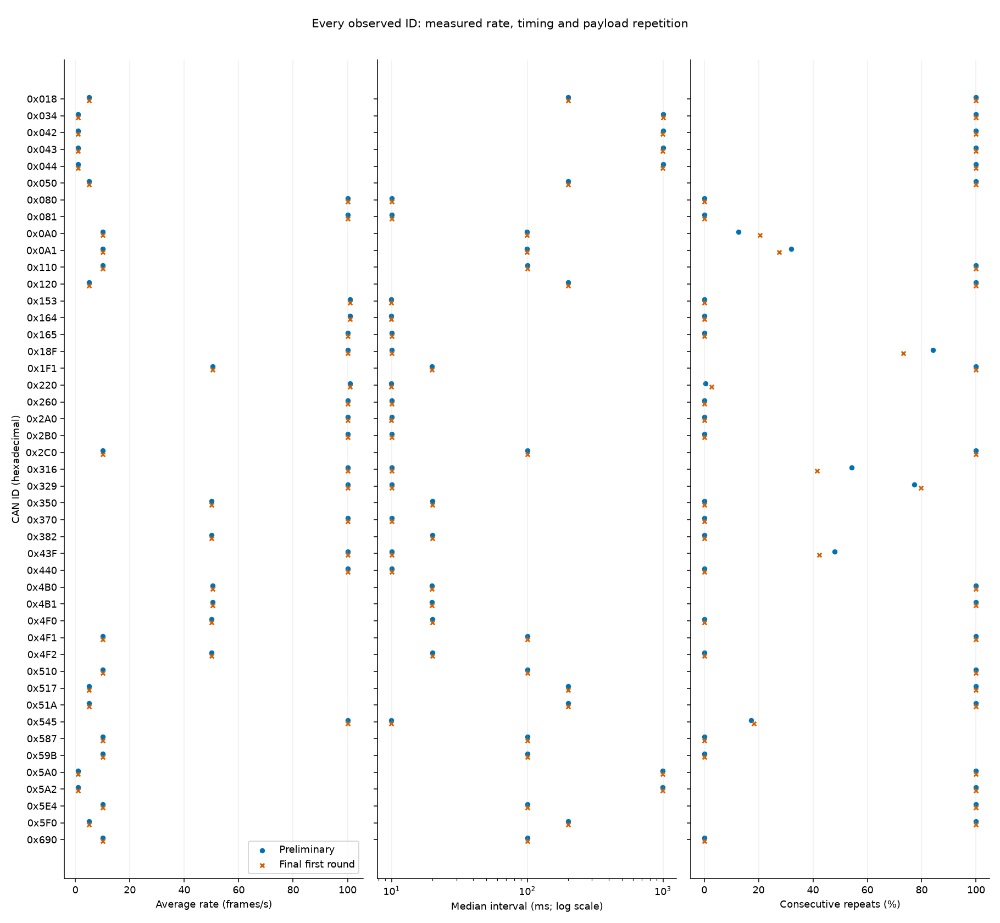

# F00 — Normal Kia Soul CAN traffic: findings and explanation

F00 provides a measured reference for normal communication in two specific
recordings. The main finding is stable ID presence, DLC, and approximate timing,
with substantial differences in normal payload content. A future security
experiment must account for both properties. This is descriptive protocol and
traffic analysis; it is not a trained detector or an attack evaluation.

## 1. What a CAN frame tells us

A recorded CAN frame contains a timestamp, an arbitration identifier (CAN ID),
a data length (DLC), and payload bytes. The ID selects a message type and its
arbitration priority; it is not an authenticated ECU address. DLC says how many
bytes exist. For example, DLC 3 means byte positions 0–2 exist, while positions
3–7 are absent, not zero. Byte and bit positions below are zero-based; byte 0
is first, and bit 0 is a byte's least significant bit.

Hexadecimal is simply a compact way to write numbers: `0x153` is decimal 339.
The same ID can be written `153` or `0153` in a source file. Neither writing
reveals a physical signal. This report assigns no ECU ownership or meanings
such as speed, braking, or engine RPM.

## 2. Verified inputs and capture quality

The configured paths are resolved relative to the local dataset root, using
both directory and filename:

- `car_track_preliminary_train/Attack_free_KIA_Soul_train.csv`
- `car_track_final_1st_train/Attack_free_KIA_Soul_train.csv`

Only these two attack-free Kia files were analyzed. Their normal designation
comes from dataset context, not an independent proof of every security property.
The Data Engineer's original parser and feature script ran unchanged on an
isolated two-file workspace. Their source files and the original recordings
were not modified. No attack file was read for this experiment.

| Recording | Frames | Duration (s) | IDs | Total observed frames/s |
|---|---:|---:|---:|---:|
| Preliminary | 192,516 | 92.122059 | 45 | 2089.793 |
| Final first round | 473,212 | 226.449112 | 45 | 2089.706 |

Together there are **665,728 frames**, verifying the previous findings rather
than assuming them as required outputs. Each file contains the same 45 IDs.
All canonical payload/DLC checks pass. No nonpositive absolute timestamp,
backward bus timestamp, equal adjacent bus timestamp, zero same-ID interval,
or negative same-ID interval was observed. There are 192,471 preliminary and
473,167 final same-ID intervals: each ID's first frame has no predecessor.

Counts and rates do not measure bus utilization: bitrate, frame overhead, and
other physical-link details would be needed for that. Raw-file hashes remain
unchanged before and after processing. The full provenance is in
[the measured summary](../results/kia_normal_summary.json).

## 3. ID inventory: which messages dominate?

The [90-row ID profile](../results/kia_normal_id_profile.csv) contains one row
per recording/ID, including decimal/hex ID, count, percentage, DLC counts,
first/last timestamps, observation spans, rates, timing and payload statistics.
The [45-row comparison](../results/kia_normal_recording_comparison.csv) brings
the two recordings together without conflating their identical filenames.

`0x153`, `0x164`, and `0x220` are the three largest contributors. Each appears
9,288–9,289 times in the preliminary and 22,831–22,832 times in the final file,
about 4.82% of frames and 100.8 frames/s per ID. Thirteen further IDs contribute
about 100 frames/s each. At the other end, `0x034`, `0x042`, `0x043`, `0x044`,
`0x5A0`, and `0x5A2` occur approximately once per second, with only 92 frames
per ID in the preliminary file and 226–227 in the final file.

Every ID has a constant DLC within each recording and the same DLC across both.
Shorter messages are `0x050`, `0x120`, `0x5A2` (DLC 4), `0x2B0` (DLC 5),
`0x5E4` (DLC 3), and `0x5F0` (DLC 2). The other 39 IDs use DLC 8. This does
not mean the short messages contain zero-filled eight-byte payloads.

Each pair of bars uses its own recording's frame count as denominator. Similar
bar heights show similar traffic composition despite different recording lengths.
A high count alone does not identify an ECU or make a message more suspicious.

## 4. Timing: average rate is not precise periodicity

An interval is the elapsed time between consecutive frames of the same ID
within the same recording. A 10 ms interval corresponds to roughly 100 frames
per second, or 100 Hz. Periodic traffic repeats near a characteristic interval;
irregular traffic has a less concentrated distribution. Small deviations from
the center are called timing jitter. An average of 100 frames/s could also
come from bursts separated by silence, so the average alone is insufficient.

The median is the middle interval; the mean averages all intervals. Standard
deviation describes spread. Percentiles show where most observations lie:
P5–P95 encloses the central 90%. The coefficient of variation (CV) divides
standard deviation by mean so different time scales can be compared. The
[methodology](F00_Methodology.md) defines every denominator and threshold.

All measured IDs satisfy the configured median and concentration criteria for
one of these broad groups. This is a supported approximation, not an assertion
that every interval is exactly nominal:

| Timing group | IDs per recording | Preliminary traffic (%) | Final traffic (%) |
|---|---:|---:|---:|
| ~100 Hz / 10 ms | 16 | 76.6840 | 76.6821 |
| ~50 Hz / 20 ms | 7 | 16.8080 | 16.8087 |
| ~10 Hz / 100 ms | 10 | 4.7856 | 4.7862 |
| ~5 Hz / 200 ms | 6 | 1.4357 | 1.4359 |
| ~1 Hz / 1000 ms | 6 | 0.2867 | 0.2870 |

Sixteen fast IDs account for about 76.68% of all frames. That makes their
normal timing important for later rate experiments. It does not establish a
flooding threshold, and the few slow IDs are still legitimate observed traffic.

The following examples distinguish tight periodicity from a similar average
with more jitter. All quantities except CV are milliseconds:

| ID | Recording | Mean | Median | Standard deviation | P5 | P95 | CV |
|---|---|---:|---:|---:|---:|---:|---:|
| 0x153 | Preliminary | 9.9180 | 9.9189 | 0.1281 | 9.7342 | 10.0930 | 0.0129 |
| 0x153 | Final | 9.9183 | 9.9189 | 0.1224 | 9.7361 | 10.0930 | 0.0123 |
| 0x260 | Preliminary | 9.9999 | 9.9959 | 0.7715 | 8.7340 | 11.2724 | 0.0771 |
| 0x260 | Final | 10.0001 | 10.0021 | 0.7439 | 8.7692 | 11.3132 | 0.0744 |
| 0x0A0 | Preliminary | 100.0005 | 99.2905 | 3.9548 | 93.9698 | 108.9798 | 0.0395 |
| 0x0A0 | Final | 100.0009 | 99.7660 | 3.0379 | 94.4761 | 108.6879 | 0.0304 |
| 0x110 | Preliminary | 100.0008 | 100.0009 | 0.2096 | 99.6430 | 100.3602 | 0.0021 |
| 0x110 | Final | 100.0009 | 100.0011 | 0.1059 | 99.8230 | 100.1801 | 0.0011 |

`0x0A0` and `0x110` both average about 100 ms, but their histograms and CVs
are quite different. `0x0A0` has multiple visible concentrations, roughly
94, 99–100, and 109 ms; `0x110` is much narrower. `0x260` shows shoulders
around its 10 ms center. Several other IDs have candidate histogram peaks;
these are preserved per ID in the result table. Binning affects exact peak
centers. Scheduling, arbitration, and recorder effects are possible explanations,
not proven causes or separate message streams.

Blue is preliminary and orange is final throughout the figures. Histogram
height is probability density, so the total area is one per recording; it is
not a raw count. Compare shape and x-axis range within an ID. Each panel has
its own range, so equally wide-looking peaks can have different absolute jitter.

No positive interval crossed the configured unusually-short (<0.5 median) or
unusually-long (>1.5 median) bounds. No gap matched the configured possible
missing-cycle criterion. This means no such flags were found, not that every
transmitted frame is proven captured. Minima and maxima are still retained:
for example, final `0x545` spans 6.175–13.781 ms despite its ~10 ms center.

## 5. Payload variability and repetition

A payload can repeat later in a sequence without repeating its immediate
predecessor. The global repeat percentage counts observations after each
unique payload's first appearance. Consecutive repeat percentage counts only
identical neighboring same-ID payloads. Their difference is particularly clear
for `0x153`: only 15 unique payloads recur thousands of times, yet consecutive
payloads always differ. A counter-like cycle explains this pattern plausibly.

For comparison, `0x316` has many more unique payloads and often sends the same
payload several times in a row. Repeated normal content is therefore not,
by itself, evidence of a replay attack.

| ID | Recording | Unique payloads | Global repeats (%) | Consecutive repeats (%) | Mean changed bits/pair |
|---|---|---:|---:|---:|---:|
| 0x153 | Preliminary | 15 | 99.839 | 0.000 | 3.733 |
| 0x153 | Final | 15 | 99.934 | 0.000 | 3.733 |
| 0x260 | Preliminary | 1254 | 86.389 | 0.000 | 4.137 |
| 0x260 | Final | 1122 | 95.045 | 0.000 | 4.387 |
| 0x316 | Preliminary | 1892 | 79.464 | 54.190 | 1.694 |
| 0x316 | Final | 2266 | 89.993 | 41.565 | 2.538 |
| 0x43F | Preliminary | 255 | 97.232 | 47.910 | 1.046 |
| 0x43F | Final | 347 | 98.468 | 42.249 | 1.128 |

Hamming distance counts changed bits between payloads. For example, `00` to
`01` changes one bit, while `00` to `81` changes two. It measures structural
change, not how much a physical quantity changed. Here all four highlighted
IDs have DLC 8, so each comparison has 64 available bits.

Twenty IDs have exactly one payload within each recording. Nine of these have
different constant payloads between recordings. Thus “stable within one file”
is weaker than “one universal normal value.” The final file is also 2.46 times
longer, so raw unique counts and global repeat percentages cannot be treated
as an equal-duration statistical comparison.

Each cell is the fraction of comparable neighboring same-ID frames in which
that byte changes. Dark low values indicate little change; bright values
indicate frequent change. Gray denotes absent or uncomparable bytes. Gray is
not a zero value. The [byte profile](../results/kia_normal_byte_profile.csv)
includes counts and fractions for each individual bit. The [value histogram
table](../results/kia_normal_byte_values.csv) shows what values were actually
observed, rather than only how often they changed.

## 6. Consecutive real messages for the important IDs

Each table is a short same-ID sequence in original capture order; other IDs
occurred between these rows. Timestamps are recorded epoch seconds, and all
payload bytes are hexadecimal. The full 48-row example table includes canonical
row positions for traceability in [the saved examples](../results/kia_normal_message_examples.csv).

### 0x153

Bytes 0–5 remain `00 80 10 FF 00 FF`. Bytes 6 and 7 change on every
same-ID transition. Across each entire recording, byte 6's high nibble advances
by one through the observed states 0–14 and wraps to 0: 9,287/9,287 preliminary
and 22,831/22,831 final transitions agree. This is a strong **counter-like
hypothesis**, not a verified field definition. The dependent change in byte 7
is not enough to call it a checksum. The two files use exactly the same 15
complete payloads, despite different initial cycle positions.

Preliminary:

| Message index | Timestamp (s) | Payload |
|---:|---:|---|
| 0 | 1513920254.790976 | `00 80 10 FF 00 FF 20 AE` |
| 1 | 1513920254.800785 | `00 80 10 FF 00 FF 30 BE` |
| 2 | 1513920254.810788 | `00 80 10 FF 00 FF 40 CE` |
| 3 | 1513920254.820744 | `00 80 10 FF 00 FF 50 DE` |
| 4 | 1513920254.830487 | `00 80 10 FF 00 FF 60 EE` |
| 5 | 1513920254.840482 | `00 80 10 FF 00 FF 70 FE` |

Final first round:

| Message index | Timestamp (s) | Payload |
|---:|---:|---|
| 0 | 1513923742.173206 | `00 80 10 FF 00 FF 00 8E` |
| 1 | 1513923742.183114 | `00 80 10 FF 00 FF 10 9E` |
| 2 | 1513923742.193049 | `00 80 10 FF 00 FF 20 AE` |
| 3 | 1513923742.202959 | `00 80 10 FF 00 FF 30 BE` |
| 4 | 1513923742.212880 | `00 80 10 FF 00 FF 40 CE` |
| 5 | 1513923742.222823 | `00 80 10 FF 00 FF 50 DE` |

### 0x260

In these preliminary examples byte 7 progresses `0D, 1C, 2B, 38, 0B,
1A`; its high nibble follows 0,1,2,3,0,1 while other bits also change. Across
both full recordings this four-state high-nibble cycle matches every transition
(9,212 preliminary and 22,644 final). It is counter-like; the low nibble's
purpose remains unknown. Bytes 2–4 are stable in both files. Byte 0 is stable
at `05` in the preliminary file but takes two values in the final file. No
checksum algorithm or diagnostic service is decoded from these bytes.

Preliminary:

| Message index | Timestamp (s) | Payload |
|---:|---:|---|
| 0 | 1513920254.786339 | `05 22 00 30 FF 99 61 0D` |
| 1 | 1513920254.797222 | `05 22 00 30 FF 99 61 1C` |
| 2 | 1513920254.807123 | `05 22 00 30 FF 99 61 2B` |
| 3 | 1513920254.816115 | `05 22 00 30 FF 99 63 38` |
| 4 | 1513920254.827113 | `05 22 00 30 FF 99 63 0B` |
| 5 | 1513920254.836180 | `05 22 00 30 FF 99 63 1A` |

Final first round:

| Message index | Timestamp (s) | Payload |
|---:|---:|---|
| 0 | 1513923742.178219 | `05 33 00 30 FF 8C 65 05` |
| 1 | 1513923742.188569 | `05 33 00 30 FF 8C 65 14` |
| 2 | 1513923742.199444 | `05 33 00 30 FF 8C 65 23` |
| 3 | 1513923742.208415 | `05 33 00 30 FF 8C 65 32` |
| 4 | 1513923742.219286 | `05 32 00 30 FF 8C 63 08` |
| 5 | 1513923742.229483 | `05 32 00 30 FF 8C 63 17` |

### 0x316

The first three preliminary payloads are identical; byte 2 then changes
from `6A` to `78` and later `76`. In the final examples byte 2 changes `FE` to
`EC`, followed by repeated payloads; bytes 1,2,4 later change together. Bytes
0,6,7 remain stable within each recording. Byte 0 differs between recordings
(`05` versus `45`). More generally, byte 2 changes in 42.50% of preliminary
pairs and 53.89% of final pairs. The values are observations, not physical
measurements; correlated changes do not establish a signal definition.

Preliminary:

| Message index | Timestamp (s) | Payload |
|---:|---:|---|
| 0 | 1513920254.787526 | `05 22 6A 0B 22 18 00 7F` |
| 1 | 1513920254.797455 | `05 22 6A 0B 22 18 00 7F` |
| 2 | 1513920254.806171 | `05 22 6A 0B 22 18 00 7F` |
| 3 | 1513920254.817306 | `05 22 78 0B 22 18 00 7F` |
| 4 | 1513920254.826166 | `05 22 78 0B 22 18 00 7F` |
| 5 | 1513920254.835945 | `05 22 76 0B 22 18 00 7F` |

Final first round:

| Message index | Timestamp (s) | Payload |
|---:|---:|---|
| 0 | 1513923742.177987 | `45 33 FE 0A 33 28 00 7F` |
| 1 | 1513923742.189755 | `45 33 EC 0A 33 28 00 7F` |
| 2 | 1513923742.199681 | `45 33 EC 0A 33 28 00 7F` |
| 3 | 1513923742.209606 | `45 33 EC 0A 33 28 00 7F` |
| 4 | 1513923742.219515 | `45 32 F4 0A 32 28 00 7F` |
| 5 | 1513923742.228531 | `45 32 F4 0A 32 28 00 7F` |

### 0x43F

All six first preliminary examples repeat. Later messages do change,
so this excerpt must not be mistaken for a constant full recording. In the
final excerpt byte 5 changes `30` to `2C` to `28`; bytes 0–3 and 7 are stable
within each recording. The stable prefix differs (`10 50` versus `00 40`).
Across the full recordings byte 5 changes in 52.09% versus 57.73% of pairs.
A constant-looking prefix or a changing byte is not a protocol/physical decode.

Preliminary:

| Message index | Timestamp (s) | Payload |
|---:|---:|---|
| 0 | 1513920254.790493 | `10 50 60 FF 46 28 0A 00` |
| 1 | 1513920254.801261 | `10 50 60 FF 46 28 0A 00` |
| 2 | 1513920254.810550 | `10 50 60 FF 46 28 0A 00` |
| 3 | 1513920254.820504 | `10 50 60 FF 46 28 0A 00` |
| 4 | 1513920254.831457 | `10 50 60 FF 46 28 0A 00` |
| 5 | 1513920254.841199 | `10 50 60 FF 46 28 0A 00` |

Final first round:

| Message index | Timestamp (s) | Payload |
|---:|---:|---|
| 0 | 1513923742.179889 | `00 40 60 FF 57 30 0A 00` |
| 1 | 1513923742.190715 | `00 40 60 FF 57 30 0A 00` |
| 2 | 1513923742.200401 | `00 40 60 FF 57 30 0A 00` |
| 3 | 1513923742.210571 | `00 40 60 FF 57 2C 0A 00` |
| 4 | 1513923742.220235 | `00 40 60 FF 57 28 0A 00` |
| 5 | 1513923742.230682 | `00 40 60 FF 57 28 0A 00` |

The left panels show the byte change fraction over the whole recording. The
right panels show raw byte 7 for the first 100 same-ID messages. This exposes
cycling and stable fields without inventing physical units. A flat early
excerpt does not imply that the rest of the recording is flat.

The automated limited checksum-like search also found whole-payload XOR = 0
for `0x164`, `0x165`, and `0x350` in every observed frame of both recordings.
That mathematical conservation is measured; interpreting it as an integrity
check remains a hypothesis. Redundant or constrained fields can produce the
same relationship. No checksum field or algorithm is verified.

## 7. Comparison of all 45 IDs

All IDs are present in both recordings, with matching DLC sets. Average rate
changes are below 0.377% and median-interval changes below 0.479% for every
ID. These are descriptive differences, not significance tests. Small count
boundary effects especially matter for slow IDs. The plots and table show that
similar timing does not imply identical payload distributions.

The middle panel uses a logarithmic timing scale to show 10 and 1000 ms in one
view. Blue/orange points close together indicate similar measurements; they
can overlap. The right panel makes differences in consecutive repetition
visible. Raw payload cardinality is influenced by the different durations.

The following compact table covers every ID. P/F means preliminary/final;
U means distinct complete payloads. Payload Jaccard is shared distinct payloads
divided by their union: 1 means identical observed sets, 0 means disjoint sets.
A matching constant value or repeating counter does not establish duplicated
recordings. All other measurements are in the full comparison CSV.

| ID (hex / decimal) | DLC | Frames P / F | Median ms P / F | U P / F | Payload Jaccard |
|---|---:|---:|---:|---:|---:|
| 0x018 / 24 | 8 | 461 / 1,133 | 200.001 / 200.002 | 1 / 1 | 0.000 |
| 0x034 / 52 | 8 | 92 / 226 | 1000.005 / 1000.008 | 1 / 1 | 1.000 |
| 0x042 / 66 | 8 | 92 / 226 | 1000.151 / 999.684 | 1 / 1 | 0.000 |
| 0x043 / 67 | 8 | 92 / 226 | 1000.151 / 999.684 | 1 / 1 | 0.000 |
| 0x044 / 68 | 8 | 92 / 226 | 1000.151 / 999.685 | 1 / 1 | 0.000 |
| 0x050 / 80 | 4 | 461 / 1,133 | 200.001 / 200.002 | 1 / 1 | 0.000 |
| 0x080 / 128 | 8 | 9,213 / 22,645 | 10.004 / 10.003 | 7609 / 11611 | 0.000 |
| 0x081 / 129 | 8 | 9,213 / 22,644 | 10.005 / 10.003 | 48 / 96 | 0.000 |
| 0x0A0 / 160 | 8 | 921 / 2,265 | 99.290 / 99.766 | 749 / 877 | 0.000 |
| 0x0A1 / 161 | 8 | 921 / 2,265 | 99.283 / 99.756 | 57 / 67 | 0.000 |
| 0x110 / 272 | 8 | 922 / 2,265 | 100.001 / 100.001 | 1 / 1 | 0.000 |
| 0x120 / 288 | 4 | 460 / 1,132 | 200.001 / 200.001 | 1 / 1 | 1.000 |
| 0x153 / 339 | 8 | 9,288 / 22,832 | 9.919 / 9.919 | 15 / 15 | 1.000 |
| 0x164 / 356 | 8 | 9,289 / 22,831 | 9.932 / 9.921 | 16 / 16 | 1.000 |
| 0x165 / 357 | 8 | 9,212 / 22,645 | 9.999 / 9.999 | 79 / 1762 | 0.044 |
| 0x18F / 399 | 8 | 9,213 / 22,645 | 9.987 / 9.989 | 75 / 174 | 0.000 |
| 0x1F1 / 497 | 8 | 4,644 / 11,416 | 19.837 / 19.837 | 1 / 1 | 0.000 |
| 0x220 / 544 | 8 | 9,288 / 22,832 | 9.931 / 9.927 | 3655 / 3858 | 0.153 |
| 0x260 / 608 | 8 | 9,213 / 22,645 | 9.996 / 10.002 | 1254 / 1122 | 0.000 |
| 0x2A0 / 672 | 8 | 9,213 / 22,644 | 9.987 / 9.957 | 12 / 24 | 0.000 |
| 0x2B0 / 688 | 5 | 9,212 / 22,644 | 10.000 / 9.999 | 16 / 32 | 0.500 |
| 0x2C0 / 704 | 8 | 921 / 2,267 | 99.945 / 99.926 | 1 / 1 | 1.000 |
| 0x316 / 790 | 8 | 9,213 / 22,645 | 9.995 / 10.000 | 1892 / 2266 | 0.000 |
| 0x329 / 809 | 8 | 9,213 / 22,644 | 10.014 / 9.997 | 55 / 40 | 0.000 |
| 0x350 / 848 | 8 | 4,605 / 11,326 | 20.002 / 19.992 | 48 / 559 | 0.000 |
| 0x370 / 880 | 8 | 9,212 / 22,643 | 9.998 / 9.999 | 4 / 4 | 1.000 |
| 0x382 / 898 | 8 | 4,606 / 11,322 | 19.979 / 19.951 | 4 / 4 | 1.000 |
| 0x43F / 1087 | 8 | 9,212 / 22,643 | 9.997 / 9.997 | 255 / 347 | 0.000 |
| 0x440 / 1088 | 8 | 9,212 / 22,643 | 9.997 / 9.996 | 479 / 328 | 0.085 |
| 0x4B0 / 1200 | 8 | 4,644 / 11,415 | 19.838 / 19.838 | 1 / 1 | 1.000 |
| 0x4B1 / 1201 | 8 | 4,645 / 11,416 | 19.838 / 19.839 | 1 / 1 | 0.000 |
| 0x4F0 / 1264 | 8 | 4,607 / 11,323 | 19.989 / 19.995 | 128 / 128 | 0.000 |
| 0x4F1 / 1265 | 8 | 921 / 2,265 | 99.992 / 99.984 | 1 / 1 | 0.000 |
| 0x4F2 / 1266 | 8 | 4,607 / 11,323 | 19.977 / 19.983 | 640 / 640 | 0.000 |
| 0x510 / 1296 | 8 | 921 / 2,264 | 99.999 / 100.000 | 1 / 1 | 1.000 |
| 0x517 / 1303 | 8 | 460 / 1,132 | 200.000 / 200.001 | 1 / 1 | 1.000 |
| 0x51A / 1306 | 8 | 461 / 1,132 | 199.986 / 199.975 | 1 / 1 | 1.000 |
| 0x545 / 1349 | 8 | 9,213 / 22,644 | 9.959 / 9.975 | 4543 / 7339 | 0.000 |
| 0x587 / 1415 | 8 | 921 / 2,265 | 100.002 / 100.004 | 15 / 15 | 1.000 |
| 0x59B / 1435 | 8 | 922 / 2,264 | 99.991 / 99.993 | 4 / 4 | 1.000 |
| 0x5A0 / 1440 | 8 | 92 / 227 | 999.459 / 999.274 | 1 / 1 | 1.000 |
| 0x5A2 / 1442 | 4 | 92 / 227 | 999.434 / 999.296 | 1 / 1 | 1.000 |
| 0x5E4 / 1508 | 3 | 922 / 2,264 | 100.004 / 99.998 | 1 / 1 | 1.000 |
| 0x5F0 / 1520 | 2 | 461 / 1,133 | 199.971 / 199.927 | 1 / 1 | 1.000 |
| 0x690 / 1680 | 8 | 921 / 2,265 | 99.922 / 99.913 | 16 / 16 | 0.000 |

For example, `0x165` changes from 79 to 1,762 observed payloads, whereas `0x260`
has fewer distinct payloads in the longer final file (1,122 versus 1,254).
This is evidence of different observed normal content, not evidence of attacks
or a decoded change in vehicle operation. Nine constant-per-file IDs switch
their constant value, reinforcing that one capture is not a complete normal
payload dictionary.

The raw file hashes differ. Their recorded timestamp ranges do not overlap;
the gap from the preliminary end to final start is 3,395.265 seconds. There
are zero shared exact timestamp/ID/DLC/payload tuples and zero shared ordered
16-frame ID/DLC/payload windows even when timestamps are excluded. These checks
argue against byte-identical files, overlapping frames, or a simple time-shifted
copy of an uninterrupted 16-frame bus sequence.

They do not rule out shorter/edited copies, related operating conditions,
a continuing measurement campaign, or a shared acquisition session. Similar
IDs/timing are expected for the same vehicle. **Acquisition-session independence
cannot be confirmed without supporting metadata.** We therefore describe two
recordings, not two independently sampled sessions.

## 8. What this reference supports, and what it cannot establish

Supported observations are the measured ID/DLC vocabulary, per-recording
frequency/timing distributions, byte/bit changes, normal repetition, the
specified counter-like relationships, and the documented comparison checks.
These can guide later questions about deviations from this limited reference.
They do not specify attack thresholds or show detector performance.

The evidence does not establish ECU ownership, signal meaning, diagnostic
services, actual lost transmissions, physical effects, a verified checksum,
independent sessions, or normality in different driving conditions. Previous
protocol exploration found no confirmed UDS traffic; F00 performs no new UDS
investigation. No attack experiment, model development, physical CAN operation,
or teammate pipeline change is included.

## 9. Verification and reproducibility

The measured artifacts were generated by commit `e57b1da22bb6b82c0a4e8a1098d8f77af0d6a493`,
with profiling code introduced in `4a23587`. The [experiment README](../README.md)
provides exact commands, dependency versions, and a fresh-output workflow.

The test command `/tmp/decan-security-submit-venv/bin/python -m unittest discover -v`
passed **55 tests in 11.234 seconds**: 35 existing tests and 20 new focused F00
tests, with no failures or skips. New tests cover ID/recording separation,
positive/zero/negative/nonfinite intervals, period/mode/gap hypotheses, variable
DLC, absent bytes, bit changes, repetition definitions, counter hypotheses,
missing IDs, exact input selection, raw integrity, overwrite refusal, and
byte-identical outputs from two synthetic runs. The pre-existing integration
test still exercises the unchanged AI baseline on its tiny synthetic fixture;
F00 itself never fits or evaluates an ML model.

Separately, the complete profiler was executed on the two actual selected
recordings. Thus the F00 measurements are real-data observations, not synthetic
results or historical counts copied into a report. Their agreement with
previous counts is a verification result. Raw SHA-256 checks passed throughout.
No attack-detection performance is claimed from either test category.

Two complete runs from the final recorded code revision produced **12
byte-identical artifacts**: five CSV tables, the provenance/summary JSON, and
six PNGs. The published copies match those outputs. Additional consistency
checks passed for raw nonempty-line counts versus recording totals, per-ID
counts/percentages, N-1 interval counts, DLC totals, byte histogram denominators,
bit-flip counts versus mean Hamming distance, and current source hashes.
Whitespace, local Markdown/image links, CLI help, and visual inspection of all
six figures passed. Existing Data/AI sources and their original tests remain
unchanged. These checks do not substitute for independent acquisition metadata.

## 10. Kurze Erklärung für die Vorstellung auf Deutsch

„Bei F00 habe ich zuerst den normalen CAN-Verkehr des Kia Soul untersucht.
Dafür verwende ich ausschließlich zwei als angriffsfrei gekennzeichnete
Aufzeichnungen: insgesamt 665.728 Nachrichten mit denselben 45 CAN-IDs.
Die meisten Nachrichten kommen ungefähr alle 10 Millisekunden, andere alle
20, 100, 200 oder 1.000 Millisekunden. Ich betrachte dabei nicht nur den
Durchschnitt, sondern auch die Streuung der Zeitabstände.

Außerdem untersuche ich, welche Bytes gleich bleiben und welche sich ändern.
Bei der ID 0x153 wiederholen sich zum Beispiel 15 verschiedene Datenmuster,
aber nie direkt hintereinander. Das spricht für ein zählerähnliches Muster,
beweist aber noch keine konkrete Signalbedeutung. Die beiden Aufzeichnungen
haben sehr ähnliche Zeitmuster, unterscheiden sich aber teilweise deutlich
im Nachrichteninhalt. Ihre Unabhängigkeit als Messsitzungen ist nicht belegt.

Damit entsteht eine nachvollziehbare Referenz für spätere Sicherheitsanalysen.
Es wird noch kein Modell trainiert und kein Angriff bewertet. Ohne verifizierte
Definitionen ordne ich den Bytes auch keine Größen wie Geschwindigkeit oder
Bremsstatus zu.“
